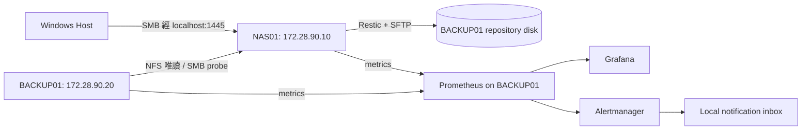

# Linux NAS Storage Operations and Disaster Recovery Lab

A hands-on storage operations lab running on two Ubuntu Server virtual machines on a single Windows laptop. It combines authenticated SMB, read-only NFS, encrypted remote Restic backups, monitoring, failure/recovery notifications and measured restore exercises.

以網路管理助教經驗為起點，模擬校園實驗室的共享資料維運。專案涵蓋「提供服務 → 備份 → 監控 → 告警 → 排錯 → 還原 → 文件化」。這是個人實驗環境，未宣稱部署於學校正式系統。

## 實作範圍

- 兩台真正的 Ubuntu 24.04 VM，透過 QEMU/WHPX 執行，具有獨立 OS、核心及虛擬資料碟。
- Samba 帳號驗證、學生唯讀與助教讀寫；NFS 指定 Client 唯讀。
- Restic 經 SFTP 備份至另一台 VM，包含加密、版本及日／週／月保留政策。
- systemd 自動備份、完整性檢查、還原測試與健康檢查。
- Prometheus、Grafana、Alertmanager 與本地通知收件匣。
- 受控誤刪、SFTP 中斷、SMB 中斷、容量壓力及資料／服務 DR 演練。
- 以 SHA-256 與 UID/GID/mode 驗證指定版本的測試資料。

驗收狀態與實測數值請查 [實測報告](reports/measured-results/README.md)；功能存在、測試通過與長期運行觀察分開記錄。

## 架構



虛擬化由企畫書的 VirtualBox 調整為 QEMU/WHPX，以配合實際 Windows 11 Home 環境。兩台 VM 各有 user-mode NAT 網卡及專用 socket 虛擬網路；主機管理服務只轉發至 `127.0.0.1`。不需變更 Windows 的既有網路分享服務。

| 服務 | Windows 存取位置 |
|---|---|
| Grafana | http://127.0.0.1:3000/d/naslab-operations |
| Prometheus | http://127.0.0.1:9090 |
| Alertmanager | http://127.0.0.1:9093 |
| 故障／恢復通知收件匣 | http://127.0.0.1:8088 |
| NAS01 SSH | `127.0.0.1:2221` |
| BACKUP01 SSH | `127.0.0.1:2222` |
| SMB | `127.0.0.1:1445`；使用支援 `-TcpPort` 的 Windows SMB mapping |

兩台 VM 仍共用同一台實體筆電。這是角色隔離，不是異地備份或高可用。詳細限制見 [limitations](docs/limitations.md)。

## 已建立環境的啟停

在 Windows PowerShell 進入此專案：

```powershell
.\Start-Lab.ps1
.\Stop-Lab.ps1
```

初始環境 NAS01 配置 3 GB RAM，BACKUP01 配置 4 GB RAM，各 2 vCPU。請等正常關機後再關閉筆電或搬移 VM 檔案。

Grafana 帳號為 `admin`。隨機產生的密碼及 SMB 帳號密碼位於本機 `.runtime/credentials.json`，該檔已排除 Git 並限制 Windows ACL。管理 SSH private key 位於 `.runtime/admin.key`。這些秘密不會放進公開報告。

## Windows SMB 存取與驗證

```powershell
.\tools\Test-WindowsSmb.ps1
```

測試會使用空閒的 `N:` 暫時掛載，驗證助教讀寫、學生唯讀後解除掛載。若該磁碟代號已使用，可加 `-Drive 'O:'`。需要 Windows 提供 `New-SmbMapping -TcpPort`；已於本次 Windows 11 環境測試。日常操作方法見 [使用手冊](docs/operations.md)。

## 維運指令

從 Windows 執行：

```powershell
py -3.12 tools/host.py exec --node nas01 --command "sudo systemctl start naslab-backup.service"
py -3.12 tools/host.py exec --node nas01 --command "sudo systemctl start naslab-verify.service"
py -3.12 tools/host.py exec --node nas01 --command "sudo systemctl start naslab-restore-test.service"
```

也可在 NAS01 的專案目錄使用 `make backup`、`make check`、`make restore-test`。預設每日 21:00 備份，每週日 22:00 保留維護、23:00 全資料完整性檢查，每週一 00:00 自動還原測試，時區為 Asia/Taipei。

`Persistent=true` 可在 VM 恢復時補跑一次錯過的日曆工作。它不會補回關機期間不存在的歷史備份，也不保證關機期間 RPO。

## 重新建置

完整步驟見 [安裝及重建手冊](docs/setup.md)。主要入口：

```powershell
py -3.12 -m pip install -r requirements-host.txt
py -3.12 tools/host.py prepare
py -3.12 tools/host.py start --accel whpx
py -3.12 tools/host.py wait
py -3.12 tools/deploy.py packages
py -3.12 tools/deploy.py configure
py -3.12 tools/dashboard.py
py -3.12 tools/deploy.py monitoring
```

準備階段需要官方 Ubuntu cloud image 與可用 QEMU；下載、校驗及系統前提在安裝手冊列明。既有 `.runtime` 是個人執行狀態，不納入 Git。

## 驗收及開發

```powershell
.\tools\Test-WindowsSmb.ps1
py -3.12 tools/acceptance.py
```

acceptance 會實際暫停實驗 VM 內的服務、刪除專用測試檔及製造受控容量壓力。請在 Lab 使用，不用於正式環境。SFTP 演練事先安排本地服務恢復計時器。

CI 檢查 Python、Shell、Compose、Prometheus 規則及告警測試。跨 VM 存取、Windows SMB 及 DR 以本地實測結果為準。

## 文件導覽

- [整體架構](docs/architecture.md)
- [安裝與重建](docs/setup.md)
- [日常操作](docs/operations.md)
- [備份與監控政策](docs/policies.md)
- [DR 計畫與實作流程](docs/dr-plan.md)
- [故障排除 Runbook](docs/runbooks/README.md)
- [已知限制](docs/limitations.md)
- [實測結果](reports/measured-results/README.md)

本專案使用成熟開源工具並自行實作維運編排、驗證及測試。Restic 是備份版本系統；來源檔案仍可能在備份期間改變，因此本版 DR 驗收使用可停止修改的靜態資料，不宣稱資料庫應用一致性。
